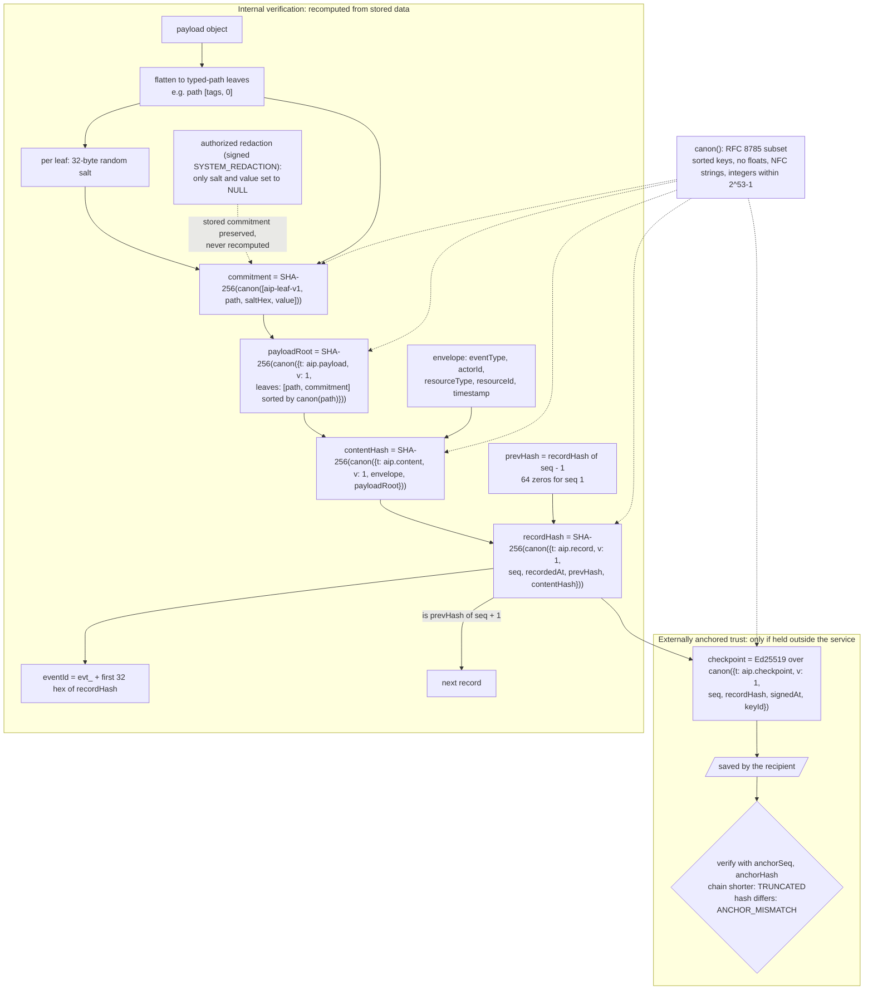
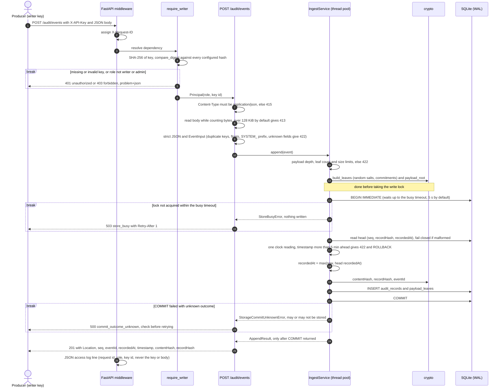
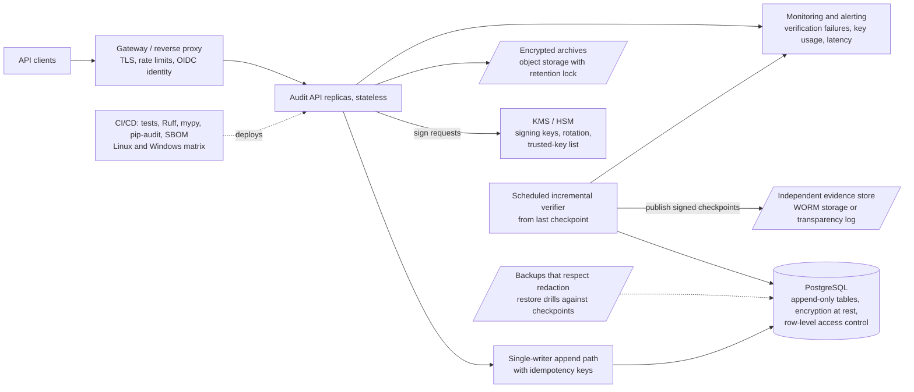

# Architecture

An overview for reviewers. The precise specifications are in DESIGN.md, referenced by section (§).
Sections 1–6 describe the **current implementation**. Section 7 is a **proposed** production design
that does not exist in this repository.

## 1. Components (current implementation)
Edges inside the service host are calls or file accesses in `src/aip`. Edges to and from "Outside
the host" are **data hand-offs, not function calls**: a checkpoint or bundle that a client receives
and keeps, an anchor passed back as query parameters, and a public key given to the offline
verifier. Dotted edges are optional. The service host is one trust boundary: anyone
who controls it (or can write the database file) is outside what internal verification can catch.
Trust that survives that comes only from the right-hand side: a checkpoint and a public key held by
someone else.

```mermaid
flowchart LR
    subgraph Clients["API clients (X-API-Key header)"]
        W["Producers: writer"]
        A["Auditors and compliance: auditor"]
        AD["Administrators: admin"]
    end
    subgraph Host["Service host, one process (trust boundary)"]
        AUTH{{"require_writer / require_reader / require_admin<br/>SHA-256 of key, compare_digest"}}
        subgraph Routes["FastAPI routes (api/)"]
            RE["POST, GET /audit/events"]
            RV["GET /audit/verify<br/>GET /audit/checkpoints/latest"]
            RL["POST /audit/events/{id}/redactions<br/>POST /audit/retention/runs"]
            RX["GET /audit/export"]
            RR["GET /audit/reports/account-access"]
        end
        ING["ingest/<br/>validation, append_in_transaction"]
        VER["verify/<br/>C1-C8, anchor check"]
        LIF["lifecycle/<br/>redaction, retention"]
        EXP["export/<br/>signed bundle"]
        REP["reports/<br/>account access"]
        CRY["crypto/<br/>canonical JSON, hashes,<br/>commitments, Ed25519"]
        STO["storage/<br/>schema v2, BEGIN IMMEDIATE, WAL"]
        DB[("SQLite<br/>audit_records, payload_leaves")]
        ARC[/"archives/run_*.json"/]
        KEY[/"Ed25519 private key, PEM"/]
    end
    subgraph Outside["Outside the host, held by recipients"]
        CP[/"Saved checkpoint: seq, recordHash"/]
        TK[/"Trusted public key, obtained out of band"/]
        VB["tools/verify_bundle.py<br/>no aip imports"]
    end
    W --> AUTH
    A --> AUTH
    AD --> AUTH
    AUTH --> RE & RV & RL & RX & RR
    RE --> ING
    RV --> VER
    RL --> LIF
    RX --> VER
    RX --> EXP
    RR --> VER
    RR --> REP
    LIF -->|"SYSTEM_* event"| ING
    ING & VER & LIF & EXP & REP --> STO
    STO --> DB
    ING & VER & LIF & EXP --> CRY
    KEY --> CRY
    LIF -->|"write before COMMIT"| ARC
    VER -->|"C8 read"| ARC
    RV -->|"signed checkpoint"| CP
    CP -->|"anchorSeq, anchorHash"| RV
    RX -->|"bundle JSON"| VB
    TK --> VB
    CP -.->|"optional anchor"| VB
```



| Component | Responsibility |
|-----------|----------------|
| `api/` | App factory, X-API-Key authentication (SHA-256 key hashes, constant-time comparison; declared in OpenAPI as the `ApiKey` scheme), roles, routes, 128 KiB body limit, RFC 9457 errors, JSON access log without secrets |
| `ingest/` | Strict event validation and payload limits; one `BEGIN IMMEDIATE` append per event (`append_in_transaction`, shared with system events) |
| `crypto/` | Pure functions: canonical JSON (RFC 8785 subset), content and record hashes, typed-path leaf commitments, payload root, timestamps, Ed25519 signing |
| `storage/` | SQLite: STRICT tables, guard triggers (schema v2), explicit transactions, WAL, raw readers for verification |
| `lifecycle/` | Authorized redaction and retention runs, archive files |
| `verify/` | Full-chain verification C1–C8 and the anchor check, with status VERIFIED / INDETERMINATE / TAMPERED |
| `export/` | Signed export bundles |
| `reports/` | Scenario C account-access report |
| `tools/verify_bundle.py` | Independent offline verifier for bundles |

Checkpoint, export and report requests run the full verification first. Checkpoint and export
refuse with 409 when it fails; the report returns the result with a status for each event.

## 2. Data model and hash chain (§1, §2, §3)
- `audit_records`: `seq`, `event_id`, the envelope (`event_type`, `actor_id`, `resource_type`,
  `resource_id`, `timestamp`), `recorded_at`, `payload_root`, `content_hash`, `prev_hash`,
  `record_hash`, `hash_version`, `archived_at`, `archive_run_id`.
- `payload_leaves`: one row per payload leaf, holding `path` (a typed path such as `["tags", 0]`),
  `commitment`, `salt` (32 random bytes) and `value`. A redacted leaf has both `salt` and `value` set to
  NULL.

```
commitment  = SHA256(canon(["aip-leaf-v1", path, saltHex, value]))
payloadRoot = SHA256(canon({"t":"aip.payload","v":1,"leaves":[[path, commitment], ...sorted by canon(path)]}))
contentHash = SHA256(canon({"t":"aip.content","v":1, eventType, actorId, resourceType, resourceId, timestamp, payloadRoot}))
recordHash  = SHA256(canon({"t":"aip.record","v":1, seq, recordedAt, prevHash, contentHash}))
prevHash(1) = 64 zeros (genesis);  eventId = "evt_" + recordHash[:32]
```
Typed paths keep array indices and object keys distinct; an earlier spike found that JSON Pointer
strings were ambiguous (§2.1). Because each leaf has its own salt, a value can be removed later while
its commitment, the payload root and every hash stay exactly as they were.

The same flow as a diagram. The left part (up to `recordHash`) is **internal verification**: the
service can recompute it, and so can anyone who can write the database file. The bottom part is
**externally anchored trust**: it holds only for checkpoints kept outside the service.
The dotted redaction edge is not a computation step. An authorized redaction removes a leaf's salt
and value and **preserves** its stored commitment, so the payload root, content hash, record hash and
every later link stay byte-for-byte unchanged. Verification checks the redacted leaf against its
signed authorization (C6) instead of recomputing it.



## 3. Request flows
**Append.** The sequence below follows `routes_events.py`, `api/auth.py`, `ingest/service.py` and
`api/errors.py`. The body limit and busy timeout are configurable defaults. Each `break` block ends
the request with the error response shown; nothing after it happens for that request. Errors raised
in the ingest service reach the client through the exception handlers in `api/errors.py`.



**Verify.** Inside one read snapshot:
1. Collect the authorization events and check their signatures against the configured key.
2. Walk every record: check links, hashes and eventId, each leaf commitment, the payload root and the
   content hash. Each redacted leaf needs a matching grant (C6); each archived row needs a signed run
   (C7) and, when the archive file is available, matching archive content (C8).
3. Stop at the first violation.

An optional anchor (an external checkpoint) also detects truncation and full rewrites.

**Redaction.** One transaction (§6.1): sign the authorization, which is bound to the record's seq,
eventId, contentHash and exact paths, append `SYSTEM_REDACTION`, then null the value and salt. Nothing
is recomputed. A best-effort WAL checkpoint follows.

**Retention.** One transaction (§7.2):
1. Select records older than the window.
2. Write the archive file durably (temporary file, fsync, rename).
3. Sign the run, which carries the archive's SHA-256, and append `SYSTEM_RETENTION_RUN`.
4. Mark the rows archived and delete their leaves.

The archive file is deleted if the transaction rolls back, and kept if the `COMMIT` outcome is unknown.

**Export.** Verify the chain first, then build one canonical-JSON bundle from a single snapshot:
matching records, their authorization events, a hash-only skeleton of the whole chain, and a signed
manifest with a digest of each section (§8.1).

**Account-access report.** Filtered query plus full verification, with a status for each listed event
(§8.2, SCENARIO_C.md).

## 4. Signing and trust boundaries
- **One service signing key** (Ed25519, from `AIP_SIGNING_KEY_PATH`) signs checkpoints, redaction and
  retention authorizations, and export manifests. Every signed document has its own `t` tag, so a
  signature for one kind of document can't be reused as another.
- **The verifier trusts only keys from configuration**, never keys stored in the database or embedded
  in a bundle. `tools/verify_bundle.py` needs the public key on its command line.
- **External evidence.** A signed checkpoint protects against rewriting and truncation only while it is
  held outside the reach of whoever can write the database file (`anchorSeq`/`anchorHash`, or
  `--anchor-*` for the offline verifier).
- **Guard triggers** are a safety net for application bugs, not a security boundary. All tamper tests
  drop them first.

## 5. Threat model
The model covers the prototype as built. "Implemented" means code and tests exist; "proposed" means
it does not exist yet (§7).

### 5.1 Assets
| Asset | Why it matters | Where it lives |
|-------|----------------|----------------|
| Chain integrity | The audit trail's evidential value | `audit_records`, `payload_leaves` |
| Payload confidentiality | Payloads may hold client data (account numbers, identifiers) | SQLite, its WAL, archive files, export bundles, backups |
| Ed25519 signing key | Authenticates checkpoints, redactions, retention runs and bundles | PEM file at `AIP_SIGNING_KEY_PATH` |
| API keys | Grant writer, auditor or admin powers | Held by clients; only SHA-256 hashes are configured |
| Archive files | Hold archived payloads | `AIP_ARCHIVE_DIR` |
| Saved checkpoints and the trusted public key | The only trust that survives a compromised host | Held by recipients, outside the service |

### 5.2 Actors
| Actor | Capability |
|-------|------------|
| External client without a key | Can reach the HTTP port only |
| Holder of a writer, auditor or admin key (legitimate or stolen) | Everything that role allows |
| Someone with write access to the database file | Can bypass the API and drop the guard triggers |
| Someone with control of the host | Can also read the signing key and the archives |
| Someone with access to backups, archives or bundles | Can read whatever those copies contain |
| An export recipient | Holds a bundle and a public key it obtained independently |

### 5.3 Trust boundaries
1. **HTTP boundary.** API-key authentication and roles. There is no TLS or rate limiting inside the
   process; a reverse proxy has to provide them (LIMITATIONS 45).
2. **Process and host boundary.** The database, the archives and the signing key all sit inside it.
   Internal verification cannot detect anything done by someone who controls the host.
3. **External evidence.** Checkpoints and the trusted public key, held by recipients. This is the only
   protection against a coordinated rewrite.

### 5.4 Attack scenarios
| Scenario | Implemented protection | Residual risk (LIMITATIONS) | Proposed (not implemented) |
|----------|------------------------|-----------------------------|----------------------------|
| Edit, delete or reorder rows directly in SQLite, without recomputing hashes | Detected at the first changed record: `LEAF_COMMITMENT_MISMATCH`, `CONTENT_HASH_MISMATCH`, `RECORD_HASH_MISMATCH`, `SEQUENCE_GAP`, etc.; checkpoint and export then refuse with 409 | Records after the first break are only UNVERIFIED (76) | — |
| **Coordinated chain rewrite**, or truncating the tail (file write access, no signing key) | Detected **only** against a checkpoint held outside the service: `ANCHOR_MISMATCH` or `TRUNCATED` | Without such a checkpoint the result is VERIFIED (7, 8, 51–53) | Periodic checkpoints published to an independent append-only store |
| **Unauthorized redaction** (blanking a value and salt) | `UNAUTHORIZED_REDACTION`: needs a later Ed25519 grant bound to the record's seq, eventId, contentHash and path | A stolen admin key can request valid redactions (§6) | Dual control for admin actions |
| Forging or altering an authorization event (no signing key) | Fails its signature, so it covers nothing; `INVALID_AUTHORIZATION` / `UNAUTHORIZED_REDACTION` / `INVALID_ARCHIVE` | — | — |
| Faking an archival, or altering an archive file | `INVALID_ARCHIVE`, `ARCHIVE_CONTENT_MISMATCH` (signed SHA-256); a missing file gives INDETERMINATE | Archives are plaintext; availability is not monitored (3, 61, 62) | Encrypted archives in retention-locked storage |
| **Signing-key compromise** | **None.** The key is an unencrypted PEM on the host, and the service trusts its own public key | Authorizations, checkpoints and bundles can be forged; no rotation or revocation (54, 58, 68) | KMS or HSM, a list of trusted keys, rotation |
| **Export completeness** (a matching record left out) | The signed manifest lists the exported records; the offline verifier detects changed, removed, reordered or substituted records relative to it | Completeness is signer-asserted, not proven (67) | Merkle inclusion and consistency proofs |
| **Plaintext evidence** (database, WAL, archives, bundles, query results) | Redaction removes the value from the live database; `secure_delete` plus a WAL checkpoint | Not solved: plaintext at rest and in bundles, auditors see payloads (1, 3, 48, 72) | Encryption at rest, field-level access control |
| **Compromised or stale backups** | None for confidentiality. For integrity, a restored backup can be checked against a saved checkpoint | Redaction does not reach existing backups (2, 59); no backup feature exists | Backups that respect redaction, restore drills |
| Stolen writer key: injecting plausible events | Authentication and roles only; `SYSTEM_` types are rejected (422) | Valid-looking false events are accepted (15) | Per-client identity, anomaly detection |
| Reading audit data through the API | Only the auditor and admin roles can read | Reads are not themselves audited (73); no per-account authorization (74) | Read auditing (SCENARIO_C.md §5) |
| Report or export racing with appends | Each verifies the full chain first | Records appended between the verification and the build are not verified by the server (71; the same applies to reports) | Verify and build in one snapshot |

Evidence that cannot be checked (a key not trusted here, or an archive file that isn't available)
is reported as INDETERMINATE, never VERIFIED and never TAMPERED.

## 6. Limitations
Single-node SQLite, static API keys, no TLS or rate limiting in-process, no encryption at rest, no key
rotation or HSM, no external publication of checkpoints, and full-chain verification on every request.
See LIMITATIONS.md (items 1–76), FINAL_SUMMARY.md §4 and PERFORMANCE.md.

## 7. Production evolution (PROPOSED, NOT IMPLEMENTED)
Nothing in this section exists in the repository. It is the direction this design would take in
production; each row answers a documented limitation.

| Area | Current implementation | Proposed production design |
|------|------------------------|----------------------------|
| Storage | Single SQLite file, `BEGIN IMMEDIATE` single writer, WAL | PostgreSQL with append-only tables and a single-writer append path; encryption at rest ([ADR-001](adr/ADR-001-sqlite-vs-postgresql.md)) |
| Key management | Unencrypted Ed25519 PEM on the host; one key; no rotation | KMS or HSM signing; a list of trusted keys with rotation and revocation ([ADR-002](adr/ADR-002-hash-chain-and-ed25519.md)) |
| External anchoring | Checkpoints on request; the caller must keep them | Scheduled checkpoints published to an independent append-only store (WORM or transparency log) |
| Verification | Full chain on every verify, checkpoint, export and report | Incremental verification from the last trusted checkpoint, run on a schedule |
| Privacy | Plaintext at rest, in archives and in bundles; redaction doesn't reach copies | Encrypted archives (DESIGN §7.1), field-level access control, backups that respect redaction ([ADR-003](adr/ADR-003-typed-path-salted-commitments.md)) |
| Identity and access | Static API keys, three roles | Identity provider (OIDC), per-account authorization, dual control for admin actions |
| Edge | No TLS or rate limiting in-process | Reverse proxy or gateway with TLS and rate limits |
| Reliability | No idempotency keys; manual recovery (RUNBOOK.md) | Idempotency keys; automated orphan-archive cleanup |
| Observability | JSON access log | Metrics and alerts on verification failures, key usage, latency and archive availability |
| Backup and disaster recovery | None built in | Scheduled backups, restore drills checked against external checkpoints |
| Delivery | Local quality gates only, Windows tested | CI/CD on Linux and Windows: tests, Ruff, mypy, pip-audit, SBOM |


*Proposed production architecture. Not implemented.*
