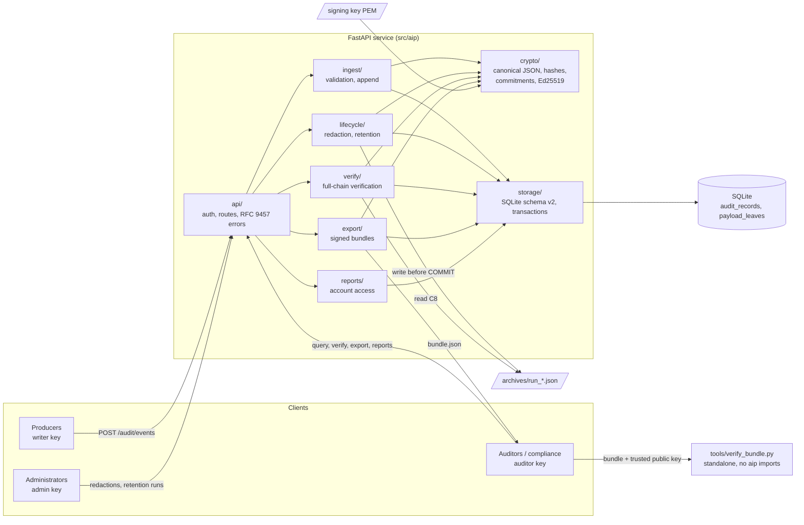

# Architecture

An overview for reviewers. The precise specifications are in DESIGN.md, referenced by section (§).

## 1. Components


| Component | Responsibility |
|-----------|----------------|
| `api/` | App factory, X-API-Key authentication (SHA-256 key hashes, constant-time comparison), roles, routes, 128 KiB body limit, RFC 9457 errors, JSON access log without secrets |
| `ingest/` | Strict event validation and payload limits; one `BEGIN IMMEDIATE` append per event (`append_in_transaction`, shared with system events) |
| `crypto/` | Pure functions: canonical JSON (RFC 8785 subset), content and record hashes, typed-path leaf commitments, payload root, timestamps, Ed25519 signing |
| `storage/` | SQLite: STRICT tables, guard triggers (schema v2), explicit transactions, WAL, raw readers for verification |
| `lifecycle/` | Authorized redaction and retention runs, archive files |
| `verify/` | Full-chain verification C1–C8 and the anchor check, with status VERIFIED / INDETERMINATE / TAMPERED |
| `export/` | Signed export bundles |
| `reports/` | Scenario C account-access report |
| `tools/verify_bundle.py` | Independent offline verifier for bundles |

## 2. Data model and hash chain (§1, §2, §3)
- `audit_records`: `seq`, `event_id`, the envelope (`event_type`, `actor_id`, `resource_type`,
  `resource_id`, `timestamp`), `recorded_at`, `payload_root`, `content_hash`, `prev_hash`,
  `record_hash`, `hash_version`, `archived_at`, `archive_run_id`.
- `payload_leaves`: one row per payload leaf, holding `path` (a typed path such as `["tags", 0]`),
  `commitment`, `salt` (32 random bytes) and `value`. A redacted leaf has both `salt` and `value` set to
  NULL.

```
commitment  = SHA256(canon(["aip-leaf-v1", path, saltHex, value]))
payloadRoot = SHA256(canon({"t":"aip.payload","v":1,"leaves":[[path, commitment], ...sorted by canon(path)]}))
contentHash = SHA256(canon({"t":"aip.content","v":1, eventType, actorId, resourceType, resourceId, timestamp, payloadRoot}))
recordHash  = SHA256(canon({"t":"aip.record","v":1, seq, recordedAt, prevHash, contentHash}))
prevHash(1) = 64 zeros (genesis);  eventId = "evt_" + recordHash[:32]
```
Typed paths keep array indices and object keys distinct; an earlier spike found that JSON Pointer
strings were ambiguous (§2.1). Because each leaf has its own salt, a value can be removed later while
its commitment, the payload root and every hash stay exactly as they were.

## 3. Request flows
**Append.** Validate the event and its limits. Build the salts, commitments and root outside the lock.
Then `BEGIN IMMEDIATE`: read the head, take one clock reading, compute the hashes, insert, `COMMIT`.
Success is reported only after `COMMIT` returns. A `COMMIT` failure with an unknown outcome is reported
as `commit_outcome_unknown`.

**Verify.** Inside one read snapshot:
1. Collect the authorization events and check their signatures against the configured key.
2. Walk every record: check links, hashes and eventId, each leaf commitment, the payload root and the
   content hash. Each redacted leaf needs a matching grant (C6); each archived row needs a signed run
   (C7) and, when the archive file is available, matching archive content (C8).
3. Stop at the first violation.

An optional anchor (an external checkpoint) also detects truncation and full rewrites.

**Redaction.** One transaction (§6.1): sign the authorization, which is bound to the record's seq,
eventId, contentHash and exact paths, append `SYSTEM_REDACTION`, then null the value and salt. Nothing
is recomputed. A best-effort WAL checkpoint follows.

**Retention.** One transaction (§7.2):
1. Select records older than the window.
2. Write the archive file durably (temporary file, fsync, rename).
3. Sign the run, which carries the archive's SHA-256, and append `SYSTEM_RETENTION_RUN`.
4. Mark the rows archived and delete their leaves.

The archive file is deleted if the transaction rolls back, and kept if the `COMMIT` outcome is unknown.

**Export.** Verify the chain first, then build one canonical-JSON bundle from a single snapshot:
matching records, their authorization events, a hash-only skeleton of the whole chain, and a signed
manifest with a digest of each section (§8.1).

**Account-access report.** Filtered query plus full verification, with a status for each listed event
(§8.2, SCENARIO_C.md).

## 4. Signing and trust boundaries
- **One service signing key** (Ed25519, from `AIP_SIGNING_KEY_PATH`) signs checkpoints, redaction and
  retention authorizations, and export manifests. Every signed document has its own `t` tag, so a
  signature for one kind of document can't be reused as another.
- **The verifier trusts only keys from configuration**, never keys stored in the database or embedded
  in a bundle. `tools/verify_bundle.py` needs the public key on its command line.
- **External evidence.** A signed checkpoint protects against rewriting and truncation only while it is
  held outside the reach of whoever can write the database file (`anchorSeq`/`anchorHash`, or
  `--anchor-*` for the offline verifier).
- **Guard triggers** are a safety net for application bugs, not a security boundary. All tamper tests
  drop them first.

## 5. Threat model and guarantees
| Adversary or failure | Outcome |
|----------------------|---------|
| Edit, delete or reorder stored rows without recomputing hashes | Detected: the first violation, with its type and location |
| Blank a payload value without authorization | Detected: `UNAUTHORIZED_REDACTION` |
| Mark a record archived without a signed run, or alter an archive file | Detected: `INVALID_ARCHIVE` / `ARCHIVE_CONTENT_MISMATCH` |
| Forge or alter an authorization (no signing key) | Detected: it fails its signature, so it covers nothing |
| Rewrite the chain consistently, or truncate the tail (file write access, no key) | Detected **only** against an external checkpoint; otherwise the result is VERIFIED (L1 limit, §5) |
| Alter, reorder, remove or substitute records in an export bundle | Detected offline, under a key trusted out of band |
| Steal the signing key or the host | Not protected: authorizations and bundles can be forged (LIMITATIONS 54, 58) |
| Read the database, archives or bundles | Not protected: plaintext at rest (LIMITATIONS 1, 3, 72) |
| Steal an admin API key | Valid-looking redactions and retention runs (§6) |

Evidence that cannot be checked (a key not trusted here, or an archive file that isn't available)
is reported as INDETERMINATE, never VERIFIED and never TAMPERED.

## 6. Limitations
Single-node SQLite, static API keys, no TLS or rate limiting in-process, no encryption at rest, no key
rotation or HSM, no external publication of checkpoints, and full-chain verification on every request.
See LIMITATIONS.md (items 1–76) and FINAL_SUMMARY.md §6.
